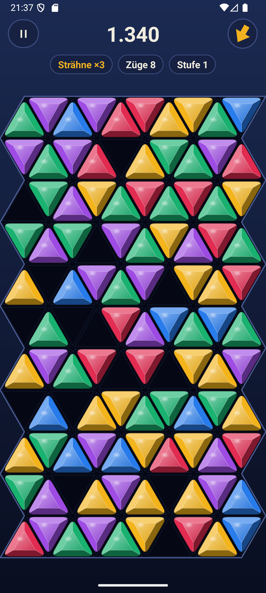
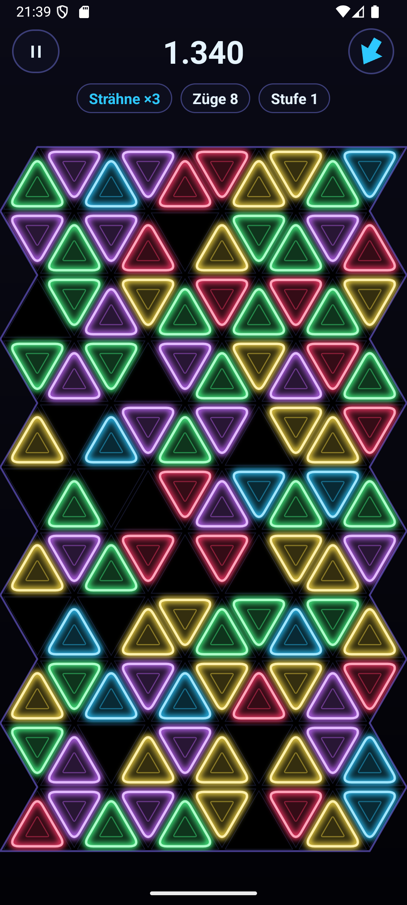

# Trinity-NEXT

A tilt-and-slide puzzle for Android. The field is made of triangular stones in five colours.
Put a finger on a stone and drag its whole line along itself, across or along either slant; what
leaves the field at one end comes back in at the other. Bring three or more stones of one colour
together and they vanish. Then tilt the phone: the rest slide into the gaps the way you tilt it.

  
  
  
   
  <em>Trinity-NEXT 1.0.0 · Screenshots from an Android 16 emulator, November 24, 2026</em>

**[Download the latest version](https://github.com/ShakieVan/Trinity-NEXT/releases/latest)**
· [Installing and updating](INSTALLATION.md) · [Privacy](PRIVACY.md)

## How it plays

- **Move a line:** every stone lies on three lines, one across and two slanted. Drag a stone and
  its line glides along as one piece; it comes to rest a whole number of triangle widths further.
  If nothing matches, it springs back.
- **Tilt to slide:** the stones slide in one of six directions, the way the phone is tilted. They
  slide without turning over, one whole triangle width at a time, so nothing fits into a single
  gap. New stones come in from the edge only where a gap reaches it. Lay the phone flat and
  nothing slides at all.
- **Streaks:** whatever sliding brings together vanishes too, and every such clear in a row counts
  more: ×2, ×3, ×4 … Tilting again can keep a streak going. The sound climbs with it, and every
  fifth step is celebrated with fireworks.
- **Special stones:** the *prism* has every colour, the *glider* lets a line stay where you put it
  once without a match, a *clamp* holds a stone and its three lines in place, and a *bomb* counts
  down with every move.
- **Two modes:** *Challenge* (clamps and bombs join in as the game goes on; a bomb going off ends
  it) and *Relaxed* (neither, no end).
- **Three looks** (Gems, Neon, Flat), **three field sizes**, each with its own list of best games.
- **Saved after every move:** leave whenever you like and go on later.
- German and English, following the phone at first and switchable in the options.
- No advertising, no purchases, no account, no data collection.

## What was checked

Version 1.0.0 was played on an Android 16 emulator and started on a Galaxy S21 (Android 15), where a
test build of the same code also played itself for a while with the phone lying flat. **Nobody had
yet played it by hand on a phone held in the hand** when it was published: tilting on real hardware,
the sound from a phone's speaker and the vibration are unverified. See the
[release notes](releases/1.0.0.md) for the known limits.

## Version history

- **1.0.0** (November 24, 2026): first public version. [Notes](releases/1.0.0.md)

## About

Trinity-NEXT is a private, non-commercial project. Its code, graphics and sounds were made for it;
the source code is not published here. [Third-party notices](THIRD_PARTY_NOTICES.md)
