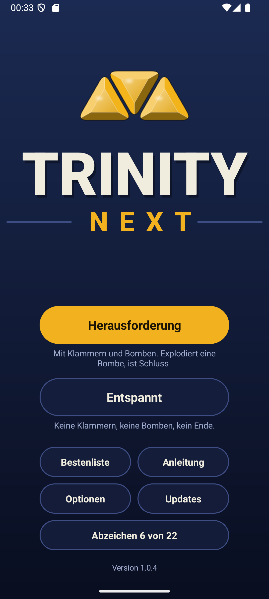
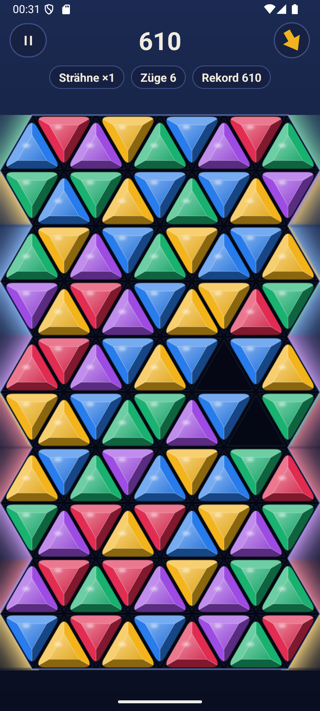
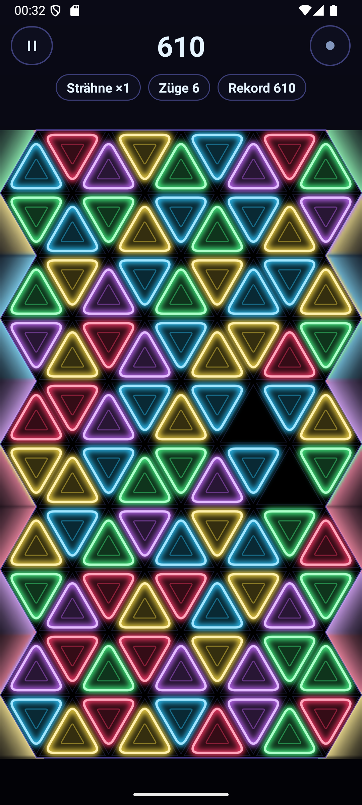
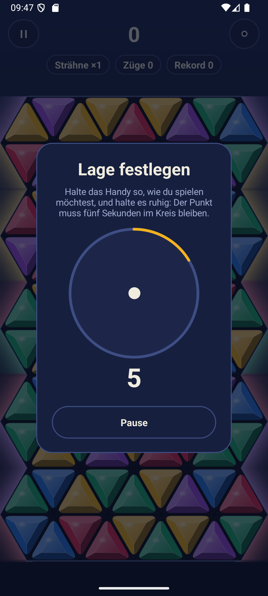
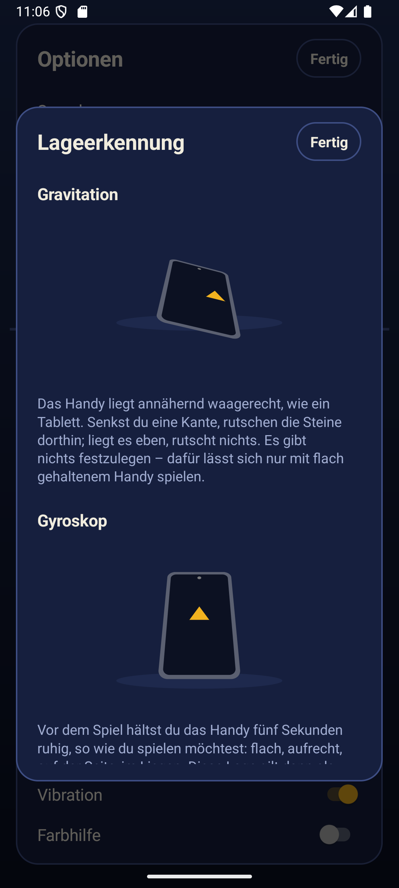

# Trinity-NEXT

A tilt-and-slide puzzle for Android. The field is made of triangular stones in five colours.
Put a finger on a stone and drag its whole line along itself, across or along either slant; what
leaves the field at one end comes back in at the other. Bring three or more stones of one colour
together and they vanish. Then tilt the phone: the rest slide into the gaps the way you tilt it.

  
  
  
   
  <em>Trinity-NEXT 1.0.4 · Screenshots from an Android 16 emulator, November 25, 2026</em>

  
  
   
  <em>Since 1.0.5: hold the phone still for five seconds the way you want to play; that position then counts as flat.
  Since 1.0.6: four ways of measuring the tilt, each explained in a moving picture</em>

**[Download the latest version](https://github.com/ShakieVan/Trinity-NEXT/releases/latest)**
· [Installing and updating](INSTALLATION.md) · [Privacy](PRIVACY.md)

> [!WARNING]
> **Google Play Protect blocked the update to version 1.0.1 in a test on November 24, 2026**
> on an Android 16 emulator ("this app may be harmful", without naming a reason, and
> without a scan having been requested). On the owner's Galaxy S24 the same update was
> installed. The classification is unexplained and not cleared.
> Details: [INSTALLATION.md](INSTALLATION.md#google-play-protect).

## How it plays

- **Move a line:** every stone lies on three lines, one across and two slanted. Drag a stone and
  its line glides along as one piece; it comes to rest a whole number of triangle widths further.
  If nothing matches, it springs back. Since 1.0.5 a white outline shows where your stone lay
  while you drag: bring it back there and no move is made.
- **Hidden stones:** at each end of a row half a triangle is missing to the edge of the screen.
  The two halves are one stone outside the field, and its colour shows in both jags as if through
  frosted glass. It does not count until it comes in: pull it out in any direction, or let it
  slide in. That way no stone ever comes back in turned over.
- **Tilt to slide:** the stones slide in one of six directions, the way the phone is tilted. They
  slide without turning over, one whole triangle width at a time, so nothing fits into a single
  gap. New stones come in from the edge only where a gap reaches it. Lay the phone flat and
  nothing slides at all. Since 1.0.2 the stones wait a moment after a clear before they slide:
  time to tilt the phone another way. Since 1.0.3 the options say how long, from a quarter of a
  second to a whole one.
- **Play in any position:** since 1.0.5 "flat" is whatever position you choose. Before a game
  begins or goes on, hold the phone still for five seconds the way you want to play, upright or
  lying down if you like; a dot has to stay inside a circle that long. From then on the stones
  slide towards the edge you tip away from you. A small black arrow in the sign at the top right
  shows the tilt as it is measured; a tap on the sign sets the position anew.
- **Four ways of measuring the tilt** (since 1.0.6), chosen in the options, where a "?" explains
  each in a moving picture. *Gyroscope* is the one just described and what everyone starts with.
  *Gravity* is the plain pull of the earth: nothing to set, but the phone has to lie about level.
  *Car ride* sets a position too but measures against gravity alone, so a bend in the road or a
  swivel chair tilts nothing; sideways you lower an edge, which on a steeply held phone is a turn
  like that of a steering wheel. *Acceleration* takes a quick jerk for a direction and ignores the
  slow way back; once the field rests, nothing slides until the next jerk.
- **Streaks:** whatever sliding brings together vanishes too, and every such clear in a row counts
  more: ×2, ×3, ×4 … Tilting again can keep a streak going. The sound climbs with it, and every
  fifth step is celebrated with fireworks.
- **Special stones:** the *prism* has every colour. The *glider*, a grey stone with a crystal, lets
  a line you drag by it stay where you put it without a match, one to five times; its crystal
  shrinks with every use and then the stone is gone. Dragged by another stone, the line springs
  back as usual and the crystal is not spent (since 1.0.5). A *clamp* keeps the three lines of its stone from being dragged
  (the stone still slides when you tilt), and a *bomb* counts down with every move.
- **Figures:** a *delta*, four stones of one colour forming a large triangle, leaves a glider in
  its middle. A *comb*, six stones around one point, takes the eighteen stones around it along.
  *Chains* of eight or more stones count double, of twelve or more threefold. A bomb cleared
  together with a prism is a *colour storm*: every stone of its colour goes.
- **Badges:** 22 of them to earn, for figures, streaks, scores and more.
- **Two modes:** *Challenge* (clamps and bombs join in as the game goes on; a bomb going off ends
  it) and *Relaxed* (neither, no end).
- **Three looks** (Gems, Neon, Flat), **three field sizes**, each with its own list of best games.
- **Saved after every move:** leave whenever you like and go on later.
- German and English, following the phone at first and switchable in the options.
- No advertising, no purchases, no account, no data collection.

## What was checked

Version 1.0.0 was played on an Android 16 emulator and started on a Galaxy S21 (Android 15), where a
test build of the same code also played itself for a while with the phone lying flat. Version 1.0.1
differs only in its icon; 1.0.2 adds the wait before sliding, 1.0.3 the gliders with a crystal, 1.0.4
the mirrored field with its hidden stones, the figures and the badges. They were checked on the
emulator, and the owner has installed 1.0.1 on a Galaxy S24 through the app; the stone that came
back in turned over, fixed in 1.0.4, was found by the owner while playing. Version 1.0.5 adds
tilting from a position of one's own: a test build showed its calibration on a Galaxy S21 lying
still, and on the emulator the signed version was calibrated upright and then tipped. Version
1.0.6 adds Car ride and Acceleration; both were checked on the emulator only, with the virtual
phone's sensors set by hand. **Tilting from a chosen position, a real car ride and the jerk
have not been tried with a phone held in the hand yet,** and tilting on real hardware, the sound
from a phone's speaker and the vibration have not been checked systematically. See the
[release notes](releases/1.0.6.md) for the known limits.

## Version history

- **1.0.6** (November 25, 2026): four ways of measuring the tilt, new among them Car ride (unmoved by bends in the road) and Acceleration (a quick jerk gives the direction); a "?" in the options explains each in a moving picture. [Notes](releases/1.0.6.md)
- **1.0.5** (November 25, 2026): tilt from a position of your own, set by holding the phone still; a small arrow shows the measured tilt; an outline marks where a dragged stone lay; a glider pays only for a move made with it. [Notes](releases/1.0.5.md)
- **1.0.4** (November 25, 2026): a mirrored field with one hidden stone for every row, figures (delta, comb, chains, colour storm), clamped stones slide along, 22 badges. [Notes](releases/1.0.4.md)
- **1.0.3** (November 24, 2026): gliders carry a crystal with one to five charges; the wait before sliding can be set in the options. [Notes](releases/1.0.3.md)
- **1.0.2** (November 24, 2026): after a clear the stones wait a second before they slide, time to tilt the phone another way. [Notes](releases/1.0.2.md)
- **1.0.1** (November 24, 2026): a better app icon, the three stones of the title screen. [Notes](releases/1.0.1.md)
- **1.0.0** (November 24, 2026): first public version. [Notes](releases/1.0.0.md)

## About

Trinity-NEXT is a private, non-commercial project. Its code, graphics and sounds were made for it;
the source code is not published here. [Third-party notices](THIRD_PARTY_NOTICES.md)
